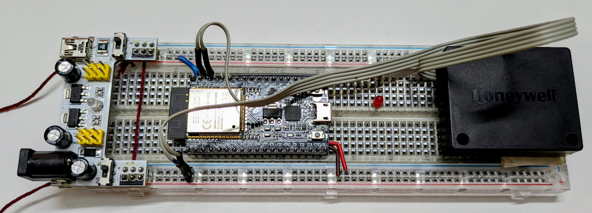
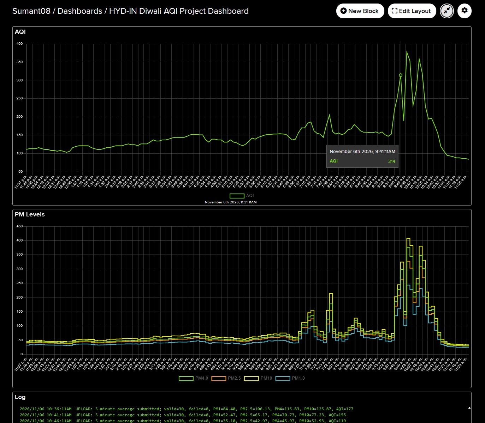

# Diwali AQI Monitor with ESP32, Honeywell HPMA115 Compact, and Adafruit IO

## Live Adafruit IO Dashboard

[View the HYD IN Diwali AQI Project Dashboard on Adafruit IO (Ctrl+Click to open in a new tab)](https://io.adafruit.com/Sumant08/dashboards/hyd-in-diwali-aqi-project-dashboard?kiosk=true)

This is a fun Diwali project that I want to do because I was curious to see how the AQI changes as we get into the Diwali celebrations. Diwali is an Indian festival of lights, sweets, and lighting firecrackers. Since firecracker activity can cause noticeable short-term changes in airborne particulate matter, this project uses a compact particle sensor, an ESP32, and Adafruit IO to observe how local particulate levels and AQI vary during the celebration.

I hope to run it from 6th Nov'26 to 11th Nov'26. 

## Project Photos

<p align="center">
  
  <br>
  <br>
  
</p>

## Project Overview

The monitor uses an **ESP32** connected to a **Honeywell HPMA115 Compact particulate-matter sensor** over UART. The ESP32 reads particle measurements every 10 seconds, builds a five-minute average, calculates an AQI value from the averaged PM2.5 and PM10 readings, and uploads the results to **Adafruit IO** over Wi-Fi.

The code also provides status indication through an LED and uploads useful system logs such as boot, reset reason, Wi-Fi/cloud connection state, sensor initialization, and measurement-upload status.

## Hardware Used

| Device / Sensor | Purpose |
|---|---|
| ESP32 development board | Main controller, UART sensor interface, Wi-Fi connectivity, averaging, AQI calculation, and cloud upload |
| Honeywell HPMA115 Compact | Measures PM1.0, PM2.5, PM4.0, and PM10 particulate concentrations |
| Status LED | Indicates successful measurements and sensor initialization failure |
| Wi-Fi network | Provides Internet connectivity to Adafruit IO |

### Connections Used by the Code

| Signal | ESP32 GPIO |
|---|---:|
| HPMA115 RX | GPIO 23 |
| HPMA115 TX | GPIO 22 |
| Status LED | GPIO 21 |

The HPMA115 interface is initialized on `Serial2` at **9600 baud, 8 data bits, no parity, 1 stop bit (8N1)**.

> Make sure the sensor UART TX/RX lines are connected to the corresponding ESP32 receive/transmit signals appropriately and that the hardware is powered according to the requirements of the boards being used.

## Software and Libraries

The project is written for the Arduino framework on ESP32.

### Main libraries / headers

| Library / Header | Use in the project |
|---|---|
| `WiFi.h` | ESP32 Wi-Fi status and IP address access |
| `esp_system.h` | Reads the ESP32 reset reason |
| `AdafruitIO_WiFi.h` | Connects the ESP32 to Adafruit IO and publishes feed values |
| `HPMA115_Compact.h` | Communicates with the Honeywell HPMA115 Compact and retrieves PM/AQI measurements |
| `aqi/aqi.h` | Calculates AQI sub-indices from averaged PM2.5 and PM10 concentrations |
| `secrets.h` | Keeps Wi-Fi and Adafruit IO credentials separate from the main application source |

The source comments identify the required Arduino libraries as **PMSensor-HPMA115** and **Adafruit IO Arduino**.

## Adafruit IO Feeds

Create the following feed keys in Adafruit IO:

| Feed | Data |
|---|---|
| `pm1` | Five-minute average PM1.0 |
| `pm25` | Five-minute average PM2.5 |
| `pm4` | Five-minute average PM4.0 |
| `pm10` | Five-minute average PM10 |
| `aqi` | AQI calculated from the averaged PM2.5 and PM10 values |
| `log` | Boot, network, sensor, warning, critical, and upload messages |

## Configuration

Create a `secrets.h` file containing your network and Adafruit IO credentials:

```cpp
#define WIFI_SSID   "YOUR_WIFI_SSID"
#define WIFI_PASS   "YOUR_WIFI_PASSWORD"
#define IO_USERNAME "YOUR_ADAFRUIT_IO_USERNAME"
#define IO_KEY      "YOUR_ADAFRUIT_IO_KEY"
```

Do not commit real Wi-Fi passwords or Adafruit IO keys to a public GitHub repository. Add `secrets.h` to `.gitignore`.

Example:

```gitignore
secrets.h
```

## How the Code Works

### 1. Boot and initialization

`setup()` starts the serial console at **115200 baud**, configures the status LED, reports that the device is booting, and records the ESP32 reset reason.

The code then calls `initializeSensor()`.

### 2. HPMA115 Compact initialization

The HPMA115 is connected through ESP32 `Serial2`:

```cpp
Serial2.begin(9600, SERIAL_8N1, HPMA_RX_PIN, HPMA_TX_PIN);
```

The firmware waits for sensor data for up to approximately **10 seconds**. If data is detected, the sensor is considered initialized and its automatic-transmission mode is disabled so that measurements can be requested by the application.

If initialization fails, a critical log is generated and the status LED enters rapid error blinking.

### 3. Connecting to Wi-Fi and Adafruit IO

The application creates an `AdafruitIO_WiFi` object using the credentials stored in `secrets.h` and calls:

```cpp
io.connect();
```

Once connected, queued startup logs are uploaded and the firmware reports information including:

- Wi-Fi connection
- ESP32 IP address
- Adafruit IO connection
- HPMA115 initialization result
- Monitoring start

### 4. Reading the particulate sensor every 10 seconds

The main `loop()` uses `millis()`-based timing rather than a long blocking measurement delay.

Every **10 seconds**, `readHPMA115()` requests a new particle measurement. A successful sample provides:

- PM1.0
- PM2.5
- PM4.0
- PM10
- instantaneous AQI reported through the HPMA115 library

The PM measurements are accumulated in 64-bit sum variables and `sampleCount` is incremented. Failed measurements are tracked separately in `failedSampleCount`.

A successful measurement also turns the status LED on briefly.

### 5. Calculating the five-minute averages

Every **300,000 ms (5 minutes)**, `publishAverage()` divides each accumulated particulate sum by the number of valid samples:

```text
Average PM = Sum of valid PM readings / Number of valid samples
```

With a 10-second measurement interval, a complete five-minute window can contain about **30 measurement opportunities** when the sensor is operating normally.

Only valid samples contribute to the average.

### 6. Calculating AQI

Rather than averaging the sensor's instantaneous AQI readings, the program first calculates the five-minute average PM2.5 and PM10 concentrations.

Those average concentrations are rounded to whole `ug/m3` values and passed to:

```cpp
aqi_pm25(...)
aqi_pm10(...)
```

The code obtains separate PM2.5 and PM10 AQI sub-indices and then selects the greater value:

```cpp
avgAQI = (aqi25 > aqi10) ? aqi25 : aqi10;
```

This makes the worse of the two particulate AQI sub-indices the value published as the overall AQI.

### 7. Publishing to Adafruit IO

If Wi-Fi and Adafruit IO are connected, the five-minute averages are uploaded to their corresponding feeds:

```cpp
pm1Feed->save(avgPM1);
pm25Feed->save(avgPM25);
pm4Feed->save(avgPM4);
pm10Feed->save(avgPM10);
aqiFeed->save(avgAQI);
```

A summary of the measurement window is also sent to the `log` feed, including valid/failed samples, PM averages, and AQI.

The accumulators are then cleared to begin the next five-minute window.

### 8. Handling sensor failures

If the HPMA115 failed to initialize, normal sensor reads are skipped and the failure counter increases.

If an individual measurement request fails, the firmware records it as a failed sample rather than including invalid data in the average.

If an entire five-minute period contains **zero valid samples**, no measurement is uploaded and a critical log entry is generated.

### 9. Connection monitoring and offline log queue

The code continuously monitors both Wi-Fi and Adafruit IO connectivity.

When cloud connectivity is unavailable, log messages are placed into a small circular queue capable of storing **10 entries**. If the queue becomes full, the oldest entry is discarded to make room for a new message.

After the connection returns, `flushLogQueue()` uploads the stored messages to the Adafruit IO `log` feed.

Measurement values themselves are not queued. If the five-minute upload occurs while the cloud connection is unavailable, that measurement upload is skipped and the condition is logged.

### 10. Status LED behavior

The status LED gives simple local feedback:

- **Normal sensor measurement:** LED turns on for approximately 1 second.
- **Sensor initialization failure:** LED toggles approximately every 200 ms, producing a fast continuous blink.

This makes it possible to spot a sensor startup problem without opening the serial monitor.

## Program Flow

```text
Power On
   |
   v
Initialize Serial + LED
   |
   v
Initialize HPMA115 Compact
   |
   v
Connect Wi-Fi + Adafruit IO
   |
   v
Start monitoring loop
   |
   +---- every 10 s ----> Read PM1 / PM2.5 / PM4 / PM10
   |                         |
   |                         +--> Accumulate valid readings
   |                         +--> Track failed readings
   |                         +--> Blink status LED
   |
   +---- every 5 min ---> Calculate PM averages
                             |
                             +--> Calculate PM2.5 AQI
                             +--> Calculate PM10 AQI
                             +--> Select higher AQI
                             +--> Upload data + log
                             +--> Reset accumulators
```

## Why Average Over Five Minutes?

A particulate sensor can show rapid short-term variations. Sampling every 10 seconds preserves responsiveness, while publishing a five-minute average produces a cleaner trend for observing how particle concentrations change during the Diwali period.

The serial output still shows individual measurements, making it useful during development and debugging, while Adafruit IO receives the summarized trend data.

## What This Project Can Show

The resulting Adafruit IO dashboard can be used to visualize:

- PM1.0 trends
- PM2.5 trends
- PM4.0 trends
- PM10 trends
- calculated particulate AQI
- timing of connection or sensor problems through the `log` feed

This makes the project a simple way to explore how the local air around the sensor changes before, during, and after Diwali celebrations.

## Important Note

This is a **fun personal monitoring and learning project**, not a regulatory air-quality monitoring station. The readings represent the conditions at the particular sensor location and should not be interpreted as an official AQI measurement for an entire city or region.

## Source File

The application documented here is implemented in `HYD_IN_Diwali_AQI_ESP32.c`.
